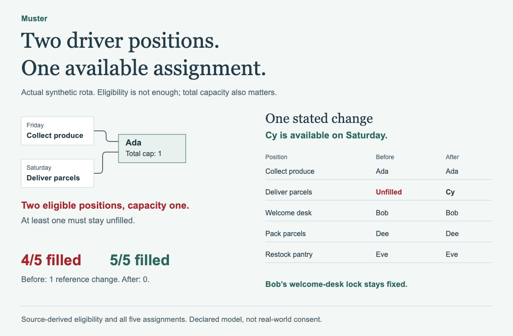

# Muster

Muster repairs volunteer rotas after a cancellation. Keep existing commitments locked, inspect the people who can cover a short-staffed position, and compare a new proposal with the reference schedule.

[Open the worksheet](https://nazeeh111.github.io/Muster/) · [Explore the recorded example](docs/presentation/README.md) · [How the solver works](docs/mechanism.md)

<picture>
  <source media="(max-width: 600px)" srcset="docs/presentation/capacity-mobile.png">
  
</picture>

**Two positions can each be fillable while their pair is not.** The [recorded native results](docs/presentation/before-result.json) identify a two-position subset with capacity one. In the [actual browser edit](docs/presentation/worksheet-desktop.png), Cy becomes available on Saturday. The repaired rota fills **5/5** positions with **zero reference changes**, retaining Bob's lock. The input change is hypothetical; it does not obtain anyone's consent.

[Download and reopen the complete case](https://github.com/nazeeh111/Muster/raw/94a096b1a284d16e24a7d789ab05e6d287b832f5/docs/presentation/worked-example.zip) · [Actual phone worksheet](docs/presentation/worksheet-mobile.png) · [Data, exact objectives and limits](docs/presentation/README.md)

The worksheet runs locally in your browser. The included rota is synthetic. [Earlier source release](https://github.com/nazeeh111/Muster/releases/tag/v0.2.1) · [Earlier worksheet capture](docs/worksheet.jpg)

## Try it locally

Serve this directory using Python 3, then open the printed local address:

```sh
python3 -m http.server 8000 --bind 127.0.0.1
# Open http://127.0.0.1:8000/
```

Use a modern browser with JavaScript modules and Web Workers. Opening `index.html` directly as a file is unsupported. You can serve the downloaded source entirely offline; no CDN, fonts, APIs, analytics or package installation are required.

The initial example has five positions and a cancellation. Two driver positions each have an eligible person, but that person can take only one assignment. The maximum is **four of five positions**, even though each driver position is individually fillable.

1. In **Review staffing**, select **Deliver parcels**. Both Ada and Cy have the Driver role. Ada has one assignment available across the two delivery blocks. Cy is unavailable on Saturday.
2. In this synthetic example, choose **Edit** beside Cy, check **Saturday · morning**, and save. On the same rota, choose **Calculate repair**. All five positions fill and Bob’s locked welcome-desk commitment stays in place.
3. Compare the proposal with the reference column. Export project JSON for later editing or an assignment CSV for human review. Editing availability neither contacts anyone nor records consent.

Use **Project setup** to add roles and time blocks, then add people and positions. Edit a position to set its reference assignment or locked commitment. In the original named-block mode, a person cannot fill two positions in the same block and blocks are assumed not to overlap. Inputs that conflict with a lock are rejected; unlock or change that commitment explicitly first.

To schedule actual shift times, choose **Add shift times** in Project setup and enter a start and end for every block. This converts the project to timed mode only after all entries and existing locks validate. Each position inherits its block's interval. A person's availability checkbox means they can cover that entire block; it does not imply availability for another overlapping block. Timed blocks may overlap, but one person cannot hold overlapping assignments. Back-to-back shifts are allowed.

Enter each endpoint with a date, minute-precision time and explicit UTC offset, for example `2026-09-26T09:00-04:00` or `2026-09-26T13:00Z`. Seconds and the unknown offset `-00:00` are rejected. An overnight shift needs the next day's end date. Offsets are supplied by you, not inferred from your computer; check the offset in effect at the event location, especially across daylight-saving changes. Muster compares the resulting instants and does not validate geographic time-zone rules. Untimed projects remain valid and are never converted automatically.

## A precise decision rule

The solver optimizes these objectives **in order**, not as interchangeable preferences:

1. Fill the most positions.
2. Among those solutions, change the fewest reference assignments. An unfilled reference position counts as changed. Filling a previously unassigned position is shown as an addition, but is not penalized as a changed commitment.
3. Among those solutions, minimize the sum of squared assignment counts across people.

For example, counts 2/0 have squared sum 4; counts 1/1 have sum 2. This balances **counts**, not hours, hardship or personal preferences. Locks are hard constraints and cannot be sacrificed for a better score. Multiple proposals can share the same optimum; tie-breaking is deterministic for the same input order.

A shortage is a collective constraint, not a suggestion to override someone's availability. In named-block mode, the solver shows a deficient set of positions and its maximum coverage. In timed mode, it reports only a proven whole-rota coverage limit. If timed search stops before proving the best result, the feasible proposal is labeled **not proven optimal** and no shortage is certified. No suggested input edit is claimed to be a smallest repair.

Read the [mechanism walkthrough](docs/mechanism.md) for the graph, tradeoffs, example and extension boundaries.

## Save, undo and review

- Valid worksheet changes are saved in browser local storage. **Export project** produces a portable JSON copy. Browser storage can be cleared or unavailable; it is not a backup or encrypted vault.
- **Undo** restores up to 30 previous input states during the current session. Proposals are invalidated whenever inputs change and recomputed after reload.
- **Use proposal as reference** explicitly accepts a new comparison baseline. It does not send or publish assignments.
- Import is limited to 1 MiB, validates before replacement, rejects duplicate JSON keys and asks before replacing the worksheet. Unknown fields are rejected so misspelled constraints cannot be silently ignored.
- The advanced JSON editor keeps unapplied drafts across calculations and model changes. Apply or explicitly discard the draft. Unapplied drafts are session-local; navigation warns before discarding them. Export project includes the validated worksheet, not an unapplied draft.
- **Download JSON draft** saves the current editing text, including unfinished or invalid JSON, as a separate text file. **Restore JSON draft** reads UTF-8 text up to 1 MiB into that editor without replacing the worksheet, proposal, undo history or saved project. An existing unapplied draft requires confirmation before replacement. Validate and replace separately when ready. Draft files are unencrypted and may contain the same private project data as the editor. Restoring uses the textarea's normal newline handling and strips an optional UTF-8 BOM; it is text recovery, not a byte-preserving file archive.
- Unreadable saved input is retained behind recovery controls. Storage failure keeps changes in memory and warns you to export. Project JSON preserves timed endpoints and their written offsets. Assignment CSV is for review, not project import: untimed exports keep the original five columns; timed exports add Start and End for every position, including unfilled ones. CSV cells are quoted, and formula-like names receive a leading apostrophe for spreadsheet safety.

## Model limits

Up to 32 people, 16 blocks, 12 roles and 64 positions. A person has role eligibility, block availability, and an integer assignment cap of 0–16. A position has one required role and occupies its entire block. Several positions may share a block; each person can take only one of them.

Untimed blocks must be mutually non-overlapping. Timed projects require a valid start and end on **every** block and use half-open intervals: a shift ending at 11:00 does not conflict with one starting at 11:00. Muster does not model travel, minimum rest, ranked preferences, historical fairness, legal compliance, notifications or live multi-user collaboration. It balances assignment counts, not hours. It is a review worksheet, not an employee scheduling or labor-policy system. Model all commitments that should consume capacity; omitted outside commitments are not inferred.

The browser stops a worker that exceeds eight seconds; then no result is shown. A timed result may instead return an earlier feasible proposal labeled unproven. Results cover only the declared model, not real-world availability or every possible scheduling rule. See [verification](docs/verification.md) for observed evidence and limits.

## Development

Node.js 22 or later, no install step:

```sh
npm test
```

Tests include seeded exhaustive enumeration of tiny schedules, simultaneous positions, lock conflicts, objective ordering, shortage capacity, input validation, storage failures and CSV handling. CI runs the same suite on Node 22 and 24. The browser UI is a separate manual acceptance surface.

Original [MIT](LICENSE) software. Muster uses established flow optimization and scheduling techniques for a small, inspectable, local repair workflow.

### Multiple tabs and local recovery

Muster serializes saves from current-version tabs using the browser's Web Locks
API and checks the saved generation before writing. If another tab changes the
saved project, this tab keeps its worksheet in memory and stops claiming it is
saved. Use **Export project** to preserve this tab's work,
then **Reload saved project** to discard it deliberately and reopen the saved
copy. Browsers that cannot provide Web Locks or a secure random generation ID
keep edits in memory only; export before closing. Storage can also fail because
of browser privacy settings or quota.

Safe coordination requires all writers to use the current app. An older tab or
another script that writes the same browser-storage key without the lock cannot
be coordinated. Close old versions before editing in multiple tabs. This is
local browser storage, not a backup or an online collaboration service.

Muster requests the browser's leave-page confirmation while a worksheet save is
pending or failed, an unapplied JSON draft exists, or an open editor has changed
fields. Cancel leaving to finish saving or copy/export the relevant work. Project
export includes the worksheet, not unapplied JSON or editor fields. Browsers may
suppress this confirmation, and a crash or forced close cannot be guarded this
way. Keep exports for work you need to preserve.
